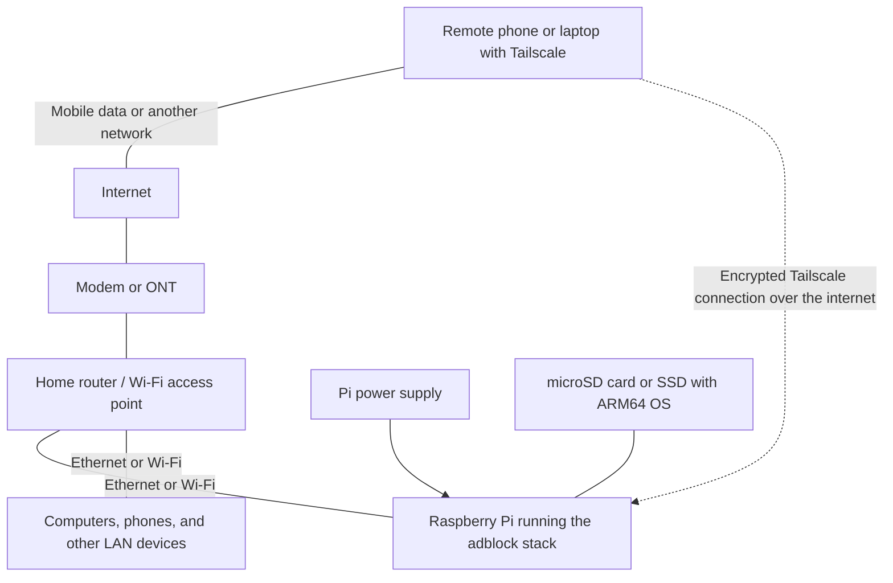
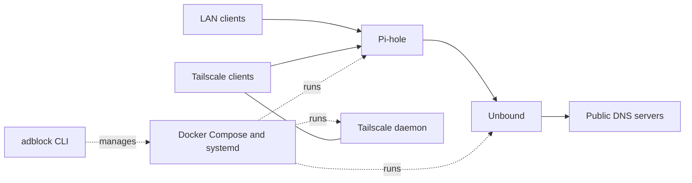

# Raspberry Pi Adblock CLI

**Network-wide ad blocking, managed from your terminal.**

Run Pi-hole, Unbound, and Tailscale on a Raspberry Pi with Docker Compose and a single `adblock` CLI. Manage DNS filtering at home, connect through your Tailnet, and handle diagnostics, backups, and network changes from one place.

[Features](#features) · [Quick Start](#quick-start) · [Usage](#usage) · [Documentation](#documentation)

## Features

### Filter DNS across your network

Use Pi-hole to block unwanted domains and manage block and allow lists from the CLI. Unbound provides recursive DNS resolution. [Manage filtering →](docs/operations.md#everyday-commands)

### Connect through Tailscale

Authenticate the Pi with your Tailnet and configure clients to use its DNS service away from home. Authentication persists across container restarts. [Set up remote access →](docs/operations.md#tailscale-and-remote-access)

### Keep operations in the terminal

Inspect service status, run diagnostics, and read logs without opening a web UI. Back up and restore data, update pinned images, or roll back an update. [Maintenance guide →](docs/operations.md#backups-updates-and-rollback)

### Recover unconfirmed IP changes

Save network profiles and change the Pi's LAN address with a confirmation window. Unconfirmed changes are scheduled for recovery after 120 seconds, with recovery retries surviving SSH disconnects and reboots. [Change network settings →](docs/operations.md#changing-the-lan-address)

## How It Works

### Hardware Setup

Connect the Pi and your home devices to the same router. The router remains the internet gateway and DHCP server; the Pi provides DNS filtering as another device on the LAN.



Solid lines show physical or network connectivity; the dotted line shows the Tailscale overlay connection. A modem/ONT may be integrated into your router or supplied by your ISP.

| Component | Setup |
| --- | --- |
| Raspberry Pi | Raspberry Pi 4 ARM64 is the verified hardware; provide its power supply and boot storage with a supported OS. |
| Router / access point | Connect the Pi by Ethernet or Wi-Fi, reserve its LAN IP, and advertise that IP as the DHCP DNS server. |
| LAN devices | Connect to the same LAN and obtain the Pi's DNS address through DHCP. |
| Remote devices (optional) | Install Tailscale, join the same Tailnet, and accept the configured Tailnet DNS settings. |

Only DNS queries are sent to the Pi; ordinary web and application traffic continues through the router. The Pi does not need to sit between the router and your devices. Remote DNS access uses Tailscale and does not require forwarding public DNS port 53 on the router. See [LAN DNS](docs/operations.md#lan-dns) and [remote access](docs/operations.md#tailscale-and-remote-access) for configuration details.

### DNS and Service Flow



Pi-hole receives client DNS queries; Unbound resolves them recursively. Docker Compose runs the services, while systemd handles startup, firewall setup, and network recovery.

## Requirements

| Requirement | Details |
| --- | --- |
| Platform | ARM64 Raspberry Pi running Debian 13 or Debian 13-based Raspberry Pi OS |
| Host services | systemd and NetworkManager |
| Resources | At least 2 GiB of free disk space and synchronized system time |
| Networking | Available DNS port 53, `/dev/net/tun`, internet access, and outbound TCP/UDP 53 |
| Access | A shell on the Pi with `sudo` privileges |

32-bit operating systems are unsupported. Newer OS versions must pass preflight checks; compatibility with unreleased versions is not guaranteed. Docker and Compose are installed from Debian packages if needed. See [installation details](docs/operations.md#installation).

## Quick Start

Copy this repository to your Pi, open a shell in its root directory, and run:

```sh
# Load the image digests used in the recorded hardware verification.
. ./release-images.env
sudo sh install.sh \
  --pihole-image "$PIHOLE_IMAGE" \
  --tailscale-image "$TAILSCALE_IMAGE" \
  --base-image "$BASE_IMAGE"

sudo systemctl status adblock
sudo adblock tailscale login
sudo adblock doctor
```

Open the URL printed by `tailscale login` to authenticate. The Tailscale authentication check is expected to fail until you log in. Installation completion means the systemd start request was registered; use service status and `doctor` to confirm readiness.

Then configure your network manually:

1. Reserve the Pi's detected LAN IP in your router's DHCP settings.
2. Set the router's LAN DHCP DNS server to that IP.
3. For remote DNS, follow the [Tailnet DNS setup](docs/operations.md#tailscale-and-remote-access).

Router-advertised IPv6 DNS and browser or app DNS-over-HTTPS can bypass Pi-hole and need separate configuration. This package blocks inbound IPv6 DNS and does not act as a DHCP server.

## Usage

```sh
sudo adblock status --json
sudo adblock doctor --json
sudo adblock logs pihole

sudo adblock block add ads.example.com
sudo adblock block remove ads.example.com
sudo adblock allow add trusted.example.com
sudo adblock allow remove trusted.example.com
```

All commands, including status queries, require `sudo` to access the Docker socket and private configuration. See the [operations guide](docs/operations.md) for network profiles, backups, updates, rollback, and removal.

## Documentation

| Guide | Contents |
| --- | --- |
| [Operations](docs/operations.md) | Installation, LAN and Tailnet DNS, network changes, commands, storage, and maintenance |
| [Verification](docs/verification.md) | Development checks, hardware evidence, acceptance scenarios, and unverified cases |

## Validation

The [hardware verification record](verification/raspberry-pi.json), dated **2026-11-15**, covers a **Raspberry Pi 4 running Debian 13 ARM64**. It records 14 passing unit tests and nine passing diagnostic checks, plus DNS/DNSSEC, filtering, backup restoration, denied ingress, network recovery, reboot startup, and Tailscale authentication checks.

The tested image digests are in [`release-images.env`](release-images.env). The [verification guide](docs/verification.md#not-yet-verified-on-hardware) lists remaining hardware scenarios separately from recorded results.
