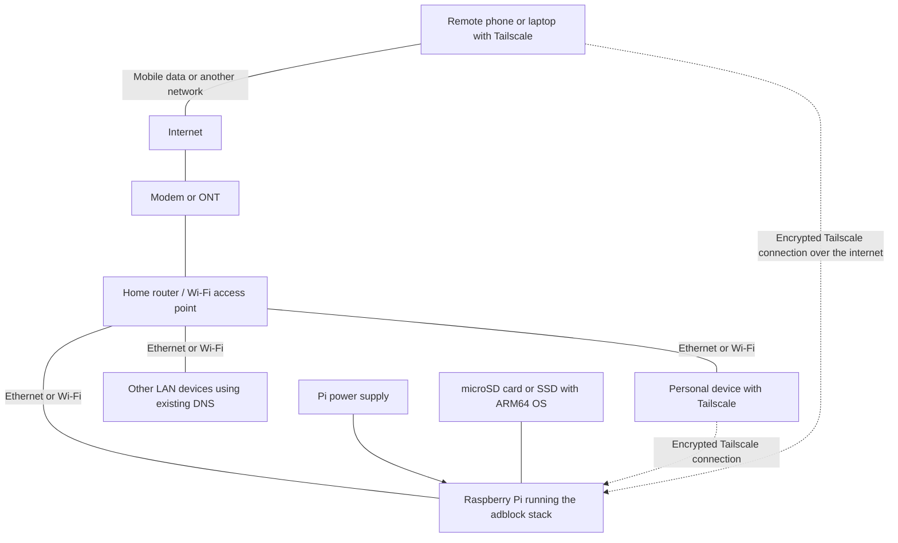
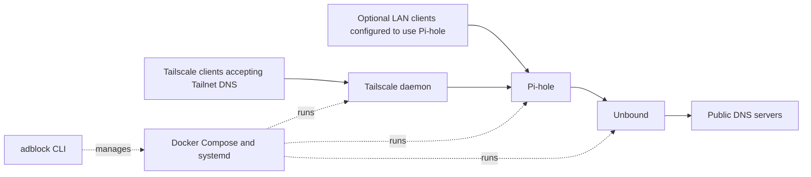

# phile-scale

**DNS filtering for your devices at home and away, managed from your terminal.**

Run Pi-hole, Unbound, and Tailscale on a Raspberry Pi with Docker Compose and a single `adblock` CLI. Start with your personal devices over Tailscale while keeping your router's DNS and DHCP settings unchanged. You can also configure individual LAN devices or advertise Pi-hole to your home network. Handle diagnostics, backups, and network changes from the same CLI.

[Features](#features) · [Choose a Configuration](#choose-a-configuration) · [Quick Start](#quick-start) · [Usage](#usage) · [Documentation](#documentation)

## Features

### Choose which devices use filtering

Use Pi-hole to block unwanted domains on devices configured to use its DNS service, and manage block and allow lists from the CLI. Unbound provides recursive DNS resolution. [Manage filtering →](docs/operations.md#everyday-commands)

### Connect through Tailscale

Authenticate the Pi with your Tailnet and configure clients to use its DNS service at home or away. Authentication persists across container restarts. [Set up Tailscale DNS →](docs/operations.md#tailscale-and-remote-access)

### Keep operations in the terminal

Inspect service status, run diagnostics, and read logs without opening a web UI. Back up and restore data, update pinned images, or roll back an update. [Maintenance guide →](docs/operations.md#backups-updates-and-rollback)

### Recover unconfirmed IP changes

Save network profiles and change the Pi's LAN address with a confirmation window. Unconfirmed changes are scheduled for recovery after 120 seconds, with recovery retries surviving SSH disconnects and reboots. [Change network settings →](docs/operations.md#changing-the-lan-address)

## Choose a Configuration

Installing the stack or joining the same Wi-Fi does not automatically enable filtering. A device's DNS queries must reach Pi-hole, either directly or through a DNS forwarder configured to use it.

| Configuration | DNS setup | Devices using filtering |
| --- | --- | --- |
| Personal devices over Tailscale (Quick Start) | Keep router DNS/DHCP unchanged; register the Pi's Tailscale IPv4 as Tailnet DNS and have clients accept it. | Connected Tailnet devices using that DNS configuration, at home or away. |
| Individual LAN devices | Set each selected device's DNS to the Pi's LAN IPv4. | Configured devices while they can reach the Pi on the LAN. |
| LAN-wide | Advertise the Pi's LAN IPv4 through the router's LAN DHCP DNS settings. | LAN devices that obtain and use that DNS setting. |
| LAN and Tailscale combined | Configure both LAN DHCP DNS and Tailnet DNS. | LAN clients using Pi-hole and connected Tailnet clients using its DNS. |

For personal use, the Tailscale configuration leaves family devices using their existing DNS settings unaffected. A shared Tailnet can include other people's devices: global DNS settings also apply to those that accept them. This is a choice of which clients use Pi-hole, not a LAN isolation mode. The package permits DNS from the configured LAN ranges as well as from Tailscale; a LAN device can still use the Pi directly.

## How It Works

### Hardware Setup

Connect the Pi to your router by Ethernet or Wi-Fi. The router remains its internet gateway and DHCP server. In the personal Tailscale configuration, the Pi still has a normal LAN connection; only the router's DNS and DHCP settings remain unchanged. Your Tailscale clients can be on this LAN or on another internet connection.



Solid lines show physical or network connectivity; dotted lines show Tailscale overlay connections. The diagram shows the personal Tailscale configuration. A modem/ONT may be integrated into your router or supplied by your ISP.

| Component | Setup |
| --- | --- |
| Raspberry Pi | Raspberry Pi 4 ARM64 is the verified hardware; provide its power supply and boot storage with a supported OS. |
| Router / access point | Provide the Pi's LAN and internet connection. Keep DNS/DHCP unchanged for personal Tailscale use. |
| Personal devices at home or away | Install Tailscale, join the same Tailnet, and accept its configured DNS settings. |
| Other LAN devices | Continue using existing DNS unless you opt into LAN filtering. |

For filtering, DNS queries are sent to the Pi; ordinary web and application traffic follows each client's usual internet connection. This package configures neither an exit node nor subnet routing. The Pi does not need to sit between the router and your devices. Remote DNS access uses Tailscale and does not require forwarding public DNS port 53 on the router. See [LAN DNS](docs/operations.md#lan-dns) and [Tailscale DNS](docs/operations.md#tailscale-and-remote-access) for configuration details.

### DNS and Service Flow



Pi-hole receives client DNS queries; Unbound resolves them recursively. Docker Compose runs the services, while systemd handles startup, firewall setup, and network recovery.

## Requirements

| Requirement | Details |
| --- | --- |
| Platform | ARM64 Raspberry Pi running Debian 13 or Debian 13-based Raspberry Pi OS |
| Host services | systemd and NetworkManager |
| Resources | At least 2 GiB of free disk space and synchronized system time |
| Networking | Available DNS port 53, `/dev/net/tun`, internet access, and outbound TCP/UDP 53 |
| Access | A shell on the Pi with `sudo` privileges |

32-bit operating systems are unsupported. Newer OS versions must pass preflight checks; compatibility with unreleased versions is not guaranteed. Docker and Compose are installed from Debian packages if needed. See [installation details](docs/operations.md#installation).

## Quick Start

### Install and Authenticate

Copy this repository to your Pi, open a shell in its root directory, and run:

```sh
# Load the image digests used in the recorded hardware verification.
. ./release-images.env
sudo sh install.sh \
  --pihole-image "$PIHOLE_IMAGE" \
  --tailscale-image "$TAILSCALE_IMAGE" \
  --base-image "$BASE_IMAGE"

sudo systemctl status adblock
sudo adblock tailscale login
```

Open the URL printed by `tailscale login` to authenticate. The Tailscale authentication check is expected to fail until you log in. Installation completion means the systemd start request was registered; use service status and `doctor` to confirm readiness.

### Configure Personal Tailscale DNS

1. After login, note the Pi's printed Tailscale IPv4 address (`100.x.y.z`). Use this address for Tailnet DNS, not its LAN IP.
2. In the [Tailscale admin DNS settings](https://login.tailscale.com/admin/dns), add that address as the global nameserver and enable **Override DNS servers**. Avoid adding an unfiltered global nameserver if you want consistent Pi-hole filtering.
3. Install Tailscale on each intended client, join the same Tailnet, connect, and enable **Use Tailscale DNS settings** (on Linux, `sudo tailscale set --accept-dns=true`). Merely connecting Tailscale does not complete the DNS setup.
4. Ensure Tailnet grants or ACLs allow these clients to reach the Pi on TCP/UDP port 53. Any additional host firewall must also allow these requests. The package already configures Pi-hole to receive them. The Pi's login command uses `--accept-dns=false`; keep that server setting separate from the clients' DNS acceptance.
5. On the Pi, run `sudo adblock doctor` to check service readiness. On a client, test DNS resolution and check that its requests appear in Pi-hole's query log; repeat from an external connection, such as mobile data. See [web UI access](docs/operations.md#storage-and-web-ui) for inspecting queries. Server diagnostics alone do not confirm client DNS routing.

No router DNS or DHCP changes are required for this path. The installer's LAN IP reservation reminder is relevant when clients will use the LAN address directly; the Tailscale path uses the Pi's Tailscale address.

### Optional LAN Filtering

For LAN-wide use:

1. Reserve the Pi's detected LAN IP in your router's DHCP settings.
2. Set the router's **LAN DHCP DNS server** to that IP. This is the DNS address advertised to clients, distinct from the router's internet/WAN DNS setting.
3. Renew client DHCP leases or reconnect clients so they receive the new setting.

For selected LAN devices only, give the Pi a stable LAN address and manually set those devices' DNS to it. Tailscale is not required on those clients while they use LAN DNS. Either LAN option can coexist with the personal Tailscale setup. See [LAN DNS](docs/operations.md#lan-dns).

### Availability and Filtering Limits

Keep the Pi powered on and connected. If Pi-hole or the connection to it fails, clients relying on it can lose domain-name resolution. In the personal Tailscale configuration, disconnecting Tailscale or disabling client acceptance of Tailscale DNS normally restores the client's previous DNS behavior; this will not bypass Pi-hole if that previous DNS also points to it.

Router-advertised IPv6 DNS and browser or app DNS-over-HTTPS can bypass Pi-hole and need separate configuration. This package blocks inbound IPv6 DNS and does not act as a DHCP server.

These setup concepts are also covered in the [Pi-hole post-install guide](https://docs.pi-hole.net/main/post-install/), [Tailscale Pi-hole guide](https://tailscale.com/docs/solutions/block-ads-all-devices-anywhere-using-raspberry-pi), and [Tailscale DNS reference](https://tailscale.com/docs/reference/dns-in-tailscale).

## Usage

```sh
sudo adblock status --json
sudo adblock doctor --json
sudo adblock logs pihole

sudo adblock block add ads.example.com
sudo adblock block remove ads.example.com
sudo adblock allow add trusted.example.com
sudo adblock allow remove trusted.example.com
```

All commands, including status queries, require `sudo` to access the Docker socket and private configuration. See the [operations guide](docs/operations.md) for network profiles, backups, updates, rollback, and removal.

## Documentation

| Guide | Contents |
| --- | --- |
| [Operations](docs/operations.md) | Installation, LAN and Tailnet DNS, network changes, commands, storage, and maintenance |
| [Verification](docs/verification.md) | Development checks, hardware evidence, acceptance scenarios, and unverified cases |

## Validation

The [hardware verification record](verification/raspberry-pi.json), dated **2026-11-15**, covers a **Raspberry Pi 4 running Debian 13 ARM64**. It records 14 passing unit tests and nine passing diagnostic checks, plus DNS/DNSSEC, filtering, backup restoration, denied ingress, network recovery, reboot startup, and Tailscale authentication checks.

The tested image digests are in [`release-images.env`](release-images.env). The [verification guide](docs/verification.md#not-yet-verified-on-hardware) lists remaining hardware scenarios separately from recorded results.

## License

This project is licensed under the [MIT License](LICENSE).
